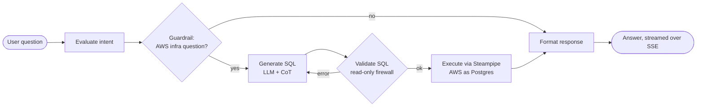

# CloudLens AI

**Ask your AWS account questions in plain English.** CloudLens AI is an agentic assistant that turns natural-language questions into safe, read-only SQL over your live AWS infrastructure, runs them, and answers conversationally.

> *"List all my public S3 buckets."* · *"How many EC2 instances are running in ap-south-1?"* · *"Sort that last list by creation date."*


## How it works



| Layer | Technology |
|---|---|
| Agent orchestration | [LangGraph](https://www.langchain.com/langgraph) state graph with conditional edges and a checkpointer |
| Data layer | [Steampipe](https://steampipe.io/): AWS APIs exposed as a PostgreSQL database, zero ETL |
| LLM | Local `gemma4:e2b` via [Ollama](https://ollama.com/): free, private inference |
| API | FastAPI with Server-Sent Events streaming of node-by-node progress |
| UI | React + TypeScript (Vite) chat interface |
| Sessions | Redis: AWS credentials cached per session with a 15-minute TTL |

## Design highlights

- **Guardrail gateway.** Off-topic prompts ("bake a cake") short-circuit straight to the response node, which blocks prompt-injection attempts from ever reaching SQL generation.
- **LLM-free security firewall.** A deterministic validator inspects every generated query and rejects anything that isn't read-only (`DROP`, `DELETE`, `UPDATE`, `INSERT`, …) before execution.
- **Self-correction loop.** If SQL fails validation or has a syntax error, the graph routes back to the generator with the error as context and retries.
- **No credentials on disk.** AWS keys are never written to env files or config. Each session's keys live in Redis under a unique `session_id` with a strict 15-minute TTL, which keeps concurrent users isolated.
- **Rolling-window memory.** A LangGraph `MemorySaver` checkpointer with a sliced context window supports follow-ups ("sort that by date") without blowing up the token budget.
- **Chain-of-thought prompting.** The model reasons in a `<thought_process>` block before writing SQL, which sharply reduces syntax errors from a small local model.
- **Least-privilege IAM.** [`streampipe/cloudlens-iam.yaml`](streampipe/cloudlens-iam.yaml) is a CloudFormation template that provisions a read-only IAM user scoped to S3, EC2 and RDS.

## Quick start (Docker)

Prerequisites: Docker, and [Ollama](https://ollama.com/) running on the host with the model pulled.

```bash
ollama pull gemma4:e2b
git clone https://github.com/shivansh-mishra-dev/cloudlens-ai.git
cd cloudlens-ai
docker compose -f docker/docker-compose.yaml up --build
```

Open http://localhost:8000, enter read-only AWS keys, and start asking questions. The image builds the React UI, installs Steampipe with the AWS plugin, and serves everything from FastAPI.

## Local development

**Prerequisites:** Python 3.12, Ollama with `gemma4:e2b`, [Steampipe](https://steampipe.io/downloads) with `steampipe plugin install aws`, Redis (`docker compose -f docker/docker-compose.yaml up -d redis-stack`), and [Bun](https://bun.sh/) for the UI.

```bash
python3 -m venv .venv && source .venv/bin/activate
pip install -r requirements.txt        # or: conda env create -f conda-env.yaml

# Option A: interactive CLI
cd src && python -m cli

# Option B: API + web UI
cd src/ui && bun install && bun run build && cd ..
python -m api.run                       # serves on http://localhost:8000
```

### Configuration

| Variable | Default |
|---|---|
| `REDIS_HOST` / `REDIS_PORT` / `REDIS_PASSWORD` | `localhost` / `6379` / `RedisPass032` |
| `OLLAMA_BASE_URL` | `http://localhost:11434` |
| `OLLAMA_MODEL` | `gemma4:e2b` |

### API

| Method | Path | Purpose |
|---|---|---|
| `POST` | `/session` | Cache AWS credentials and return a `session_id` (15-minute TTL) |
| `POST` | `/chat/stream` | Stream the agent run as SSE: `node_status` events, then `final_response` |

## Example

```text
You:   List my S3 buckets.
Agent: Here are the S3 buckets found:
       * bucket-name (Region: ap-south-1)

You:   How many objects does the first bucket have?
Agent: The bucket 'bucket-name' currently contains 42 objects.
```

## Project structure

```text
src/
├── ai/
│   ├── _langgraph/        # graph nodes: evaluate, guardrail, generate, validate, execute, format
│   ├── models/            # Ollama model connector
│   ├── tools/             # Steampipe SQL execution tool
│   ├── agent_state.py     # shared graph state
│   ├── prompts.py
│   └── session_manager.py # Redis credential cache
├── api/                   # FastAPI server, routes and schemas (SSE streaming)
├── cli/                   # interactive REPL (python -m cli)
└── ui/                    # React + TypeScript chat UI (Vite)
docker/                    # Dockerfile and docker-compose
streampipe/                # Steampipe installer and read-only IAM CloudFormation template
```

## Roadmap

- [x] LangGraph agent with guardrails, SQL firewall and self-correction
- [x] FastAPI backend with SSE streaming
- [x] React chat UI and single-container Docker build
- [ ] RAG schema injection: retrieve Steampipe table schemas from a vector store to support services beyond S3, EC2 and RDS
- [ ] Pluggable model providers (AWS Bedrock, OpenAI-compatible endpoints)
